<a href="https://luisverabyte.com">
  <picture>
    <source media="(prefers-color-scheme: dark)" srcset="assets/cover-dark.svg">
    <source media="(prefers-color-scheme: light)" srcset="assets/cover-light.svg">
    
  </picture>
</a>

<p align="center">
  <a href="#how-to-install"><b>How to install</b></a> ·
  <a href="https://github.com/luisverabyte/automated-video/raw/main/downloads/all-skills.zip">Download all</a> ·
  <a href="#in-any-ai">Without Claude</a> ·
  <a href="https://github.com/luisverabyte/video-automatico">Versión en español</a>
</p>

<p align="center">
  
  
  
  <a href="LICENSE"></a>
</p>

Editing each video used to take me over 2 hours. Now I record, hand it to Claude and 20 minutes later it comes back ready. These are the 3 skills that took me from editing my videos to delegating them.

Step 1 is the one nobody is teaching you: **your own design system**. Everyone is editing with Claude and every video looks the same. Mine don't, and nobody can tell Claude edits them, because every piece comes out with my brand. With this kit, yours come out with yours.

> [!TIP]
> Start with step 1. The other two read the file it creates, so your scripts sound like you and your subtitles wear your colors.

## The 3 steps

<table>
  <tr>
    <td width="72" valign="top"></td>
    <td>
      <h3>Build your design system &nbsp;<sub>⭐ your edge</sub></h3>
      <p>A guided interview, one question at a time: colors, typography, voice, video style and subtitle style. If you don't know design, it proposes options. At the end it hands you your <code>design-system.md</code>, the file the other two steps use.</p>
      <p><i>Works in Claude, ChatGPT, Gemini and any AI.</i></p>
      <p><a href="design-system/"><code>design-system/</code></a> · <a href="design-system/design-system.txt">plain-text version</a> · <a href="design-system/example/design-system.md">finished example</a> · <a href="https://github.com/luisverabyte/automated-video/raw/main/downloads/design-system.zip">.zip</a></p>
    </td>
  </tr>
  <tr>
    <td valign="top"></td>
    <td>
      <h3>Write your script</h3>
      <p>Scripts for Reels, TikTok and Shorts with a storytelling structure that hooks in the first seconds, in your voice. Comes with a shot table (what's seen and what's said), fun facts and notes to fact-check what you claim.</p>
      <p><i>Works in Claude and any AI that writes.</i></p>
      <p><a href="video-script/"><code>video-script/</code></a> · <a href="video-script/plain-text.md">plain-text version</a> · <a href="https://github.com/luisverabyte/automated-video/raw/main/downloads/video-script.zip">.zip</a></p>
    </td>
  </tr>
  <tr>
    <td valign="top"></td>
    <td>
      <h3>Edit your video, with subtitles</h3>
      <p>Cuts silences and repeated takes, zooms between cuts, adds word-by-word subtitles in your style, plus music and a watermark. Runs on your computer with free tools (Whisper and ffmpeg): no subscriptions.</p>
      <p><i>Edits on its own in Claude Code or Cowork. In other AIs it walks you through the commands.</i></p>
      <p><a href="edit-video/"><code>edit-video/</code></a> · <a href="edit-video/plain-text.md">plain-text version</a> · <a href="https://github.com/luisverabyte/automated-video/raw/main/downloads/edit-video.zip">.zip</a></p>
    </td>
  </tr>
  <tr>
    <td valign="top"></td>
    <td>
      <h3>Free bonus: teleprompter! &nbsp;</h3>
      <p>The kit works without it, which is why it's a gift. When you approve a script, it builds a page with only what you're going to say, in order, in your colors and with auto-scroll. You record in one go, no memorizing.</p>
      <p><a href="teleprompter/"><code>teleprompter/</code></a> · <a href="teleprompter/plain-text.md">plain-text version</a> · <a href="https://github.com/luisverabyte/automated-video/raw/main/downloads/teleprompter.zip">.zip</a></p>
    </td>
  </tr>
</table>

## How to install

<details open>
<summary><b>Claude (web, desktop or mobile)</b></summary>

1. Download the skill's `.zip` (links above). Don't unzip it.
2. In Claude, go to **Customize → Skills**.
3. Tap **+**, then **Create skill** and **Upload a skill**, and pick the `.zip`.
4. Open a new chat and ask for what you want, for example: *"Help me build my design system"*.

You need a paid Claude plan with code execution turned on. Repeat for each skill.

</details>

<details>
<summary><b>Claude Code</b></summary>

```bash
git clone https://github.com/luisverabyte/automated-video.git
cp -r automated-video/{design-system,video-script,edit-video,teleprompter} ~/.claude/skills/
```

Copy the `DESIGN-SYSTEM-FORMAT.md` file into `~/.claude/skills/design-system/`. To use them in a single project only, copy them to that project's `.claude/skills/`.

</details>

<details>
<summary><b id="in-any-ai">In any AI (ChatGPT, Gemini and others)</b></summary>

1. Open the skill's **plain-text** version (links above) and copy all of it.
2. Paste it into a new chat and send it. The AI learns the skill for that conversation.
3. When you finish step 1, save your `design-system.md` so you don't have to repeat the interview:
   - **ChatGPT:** upload it as a file to a Project or a custom GPT, along with the skill's plain text.
   - **Gemini:** create a Gem for it and upload it as knowledge.
   - **Others:** paste it at the start of every new chat, before the skill's text.

Steps 1 and 2 work fully in any AI. Step 3 needs to run programs on your computer: there it walks you through the commands for your terminal. For it to edit on its own, use Claude Code or Cowork.

</details>

## What's in this repo

```
design-system/       step 1 · interview that creates your design-system.md
video-script/        step 2 · short video scripts in your voice
edit-video/          step 3 · editing with subtitles (Python scripts + ffmpeg)
teleprompter/        bonus · a page to read while you record
downloads/           each skill as a .zip, ready to upload to Claude
DESIGN-SYSTEM-FORMAT.md    the format of the file all four share
LICENSE              MIT, original author: Luis Vera (@luisverabyte)
```

Each folder has a `SKILL.md` (for Claude) and its plain-text version (for any AI).

## Who's behind it

I'm Luis Vera, an AI Product Manager. I'm not a developer: I build with AI and share how I do it. I use these skills every week for my videos at [@luisverabyte](https://www.instagram.com/luisverabyte). My content is in Spanish, and this is the English edition of [video-automatico](https://github.com/luisverabyte/video-automatico), the original kit.

If you want to see how I use them in real life, and what I delegate each week, [subscribe to my newsletter](https://luisverabyte.com/#newsletter) (in Spanish).

## License and credit

Free under the [MIT](LICENSE) license: use it, adapt it and share it, commercial projects included. The only condition is keeping the authorship notice. If you share it or publish your own version, mention that the original kit is by **Luis Vera ([@luisverabyte](https://luisverabyte.com))** and link to this repo.

<p align="center">
  <a href="https://www.instagram.com/luisverabyte">Instagram</a> ·
  <a href="https://www.linkedin.com/in/luisverabyte">LinkedIn</a> ·
  <a href="https://www.youtube.com/@luisverabyte">YouTube</a> ·
  <a href="https://www.tiktok.com/@luisverabyte">TikTok</a>
</p>
